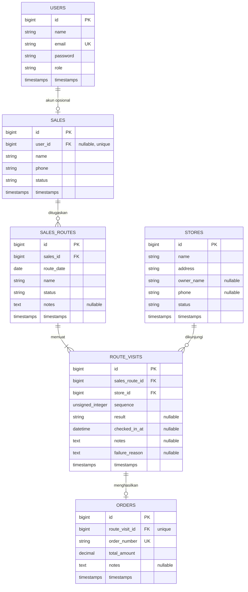

# ERD — RuteSales

**Versi:** 1.0-draft — wajib ditinjau kelompok sebelum migration final.

## 1. Diagram relasi

## 2. Definisi entitas
- `users`: akun autentikasi dan role (`admin`, `sales`).
- `sales`: profil tenaga sales; `user_id` dapat nullable jika kelompok memutuskan ada profil sales tanpa akun, tetapi semua sales yang menggunakan fitur lapangan perlu akun.
- `stores`: data toko/warung tujuan kunjungan.
- `sales_routes`: penugasan rute kepada satu sales untuk tanggal tertentu.
- `route_visits`: satu toko pada satu rute, termasuk urutan dan hasil kunjungan.
- `orders`: catatan pesanan sederhana yang terhubung ke kunjungan; unique pada `route_visit_id` untuk membatasi satu pesanan per kunjungan.

## 3. Constraint dan indeks yang disarankan
- `users.email` unique.
- `sales.user_id` nullable + unique jika satu akun hanya mewakili satu profil sales.
- `route_visits` unique gabungan (`sales_route_id`, `sequence`).
- `route_visits` unique gabungan (`sales_route_id`, `store_id`) agar toko tidak diduplikasi dalam rute yang sama.
- `orders.route_visit_id` unique.
- Foreign key disetel dengan aturan penghapusan yang menjaga riwayat. Gunakan nonaktifkan data master sebagai pilihan utama.
- Indeks pada tanggal rute, status kunjungan, foreign key, dan kolom yang sering difilter bila diperlukan.

## 4. Pertanyaan sebelum ERD dikunci
1. Apakah tabel profil sales harus terhubung wajib ke `users`?
2. Apakah satu rute per sales per hari atau beberapa rute diperbolehkan?
3. Apakah pesanan cukup total nominal, atau perlu tabel `order_items` dan katalog produk?
4. Apakah hasil kunjungan boleh diedit setelah disimpan? Jika boleh, apakah perlu audit log?
5. Apa aturan status rute: `planned`, `in_progress`, `completed`, `cancelled`?

Jangan membuat migration final sampai pertanyaan yang memengaruhi skema disetujui.
