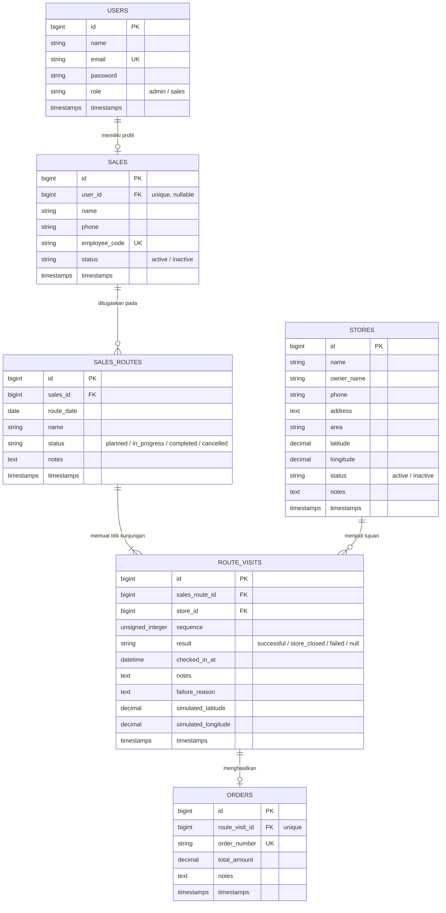

# RuteSales - Sistem Pemantauan Kunjungan Sales Lapangan

**RuteSales** adalah aplikasi berbasis web yang dirancang untuk memantau, mengelola, dan mengevaluasi aktivitas kunjungan tim sales lapangan ke toko dan warung mitra. Aplikasi ini dibangun dengan standar arsitektur **MVC (Model-View-Controller)** menggunakan **Laravel 11.x**, lingkungan pengembangan lokal **Laravel Herd**, basis data **SQLite** yang dihubungkan melalui **TablePlus**, template engine **Blade**, serta framework CSS **Tailwind CSS**.

---

## Daftar Isi
1. [Panduan Instalasi Aplikasi & Lingkungan Lokal](#1-panduan-instalasi-aplikasi--lingkungan-lokal)
2. [Daftar Fitur Utama & Modul Anggota](#2-daftar-fitur-utama--modul-anggota)
3. [Penjelasan Struktur Database (6 Entitas Relasional)](#3-penjelasan-struktur-database-6-entitas-relasional)
4. [Laporan Hasil Skenario Pengujian (TC-01 s.d TC-25)](#4-laporan-hasil-skenario-pengujian-tc-01-sd-tc-25)
5. [Akun Demo & Akses Cepat](#5-akun-demo--akses-cepat)

---

## 1. Panduan Instalasi Aplikasi & Lingkungan Lokal

Ikuti langkah-langkah berikut untuk menginstal dan menjalankan aplikasi **RuteSales** di lingkungan pengembangan lokal:

### A. Persyaratan Sistem & Tooling
- **Framework Utama**: Laravel 11.x.
- **Lingkungan Lokal**: **Laravel Herd** (untuk macOS / Windows).
- **Basis Data**: **SQLite** dihubungkan melalui **TablePlus**.
- **PHP**: Versi 8.2 atau lebih baru (`pdo_sqlite`, `mbstring`, `openssl`, `tokenizer`, `xml`, `ctype`, `json`).
- **Composer**: Versi 2.x.

### B. Konfigurasi Lingkungan Lokal via Laravel Herd
Aplikasi ini dioptimalkan untuk berjalan pada **Laravel Herd**:
1. Pastikan **Laravel Herd** sudah terpasang dan berjalan di komputer Anda.
2. Buka terminal pada direktori proyek dan hubungkan ke Herd:
   ```bash
   herd link rutesales
   ```
3. Akses otomatis melalui domain lokal:
   👉 **[http://rutesales.test](http://rutesales.test)** *(atau `php artisan serve` di `http://127.0.0.1:8000`)*.

### C. Langkah Instalasi Langkah-Demi-Langkah

1. **Pasang Dependensi PHP Menggunakan Composer**:
   ```bash
   composer install
   ```

2. **Konfigurasi Berkas Lingkungan (`.env`)**:
   Salin berkas konfigurasi `.env.example` menjadi `.env`:
   ```bash
   Copy-Item .env.example .env
   ```

3. **Generate Application Key**:
   ```bash
   php artisan key:generate
   ```

4. **Jalankan Migrasi dan Seeding Basis Data**:
   Perintah ini akan membuat skema 6 tabel relasional dan mengisinya dengan data awal realistis:
   ```bash
   php artisan migrate:fresh --seed
   ```

5. **Menjalankan Pengujian Otomatis (Feature & Unit Tests)**:
   ```bash
   php artisan test
   ```

---

## 2. Daftar Fitur Utama & Modul Anggota

Sistem RuteSales dibagi menjadi 4 modul tanggung jawab fungsional:

### A. Modul 1 — Manajemen Data Master (PIC: Rofi)
- CRUD data profil Sales dan Toko Mitra.
- Pengaturan status keaktifan (`active` / `inactive`).
- Proteksi penghapusan: Toko dan Sales yang memiliki riwayat kunjungan tidak dihapus permanen (*hard delete*), melainkan dialihkan statusnya menjadi nonaktif (*inactive*).
- Validasi formulir server-side dan proteksi token CSRF.

### B. Modul 2 — Manajemen Rute Kunjungan (PIC: Nana)
- Pembuatan rute baru dengan memilih sales aktif, tanggal, dan **beberapa toko sasaran berurutan** (`sequence`).
- Pencegahan toko duplikat pada rute yang sama.
- Halaman detail rute dinamis: `/rute/detail/{id}`.
- Pelacakan status rute: `planned`, `in_progress`, `completed`, `cancelled`.

### C. Modul 3 — Kunjungan Lapangan & Pesanan (PIC: Ammar)
- Halaman **Kunjungan Saya** khusus sales login (`/my-visits`).
- Formulir check-in transaksi dengan pencatatan waktu otomatis dari waktu server (*server-time*).
- Hasil kunjungan: `successful` (berhasil), `store_closed` (toko tutup), `failed` (ditolak).
- Validasi wajib alasan kegagalan (`failure_reason`) jika status tutup/gagal.
- Pencatatan pesanan penjualan sederhana (`orders`) khusus kunjungan berhasil (1 pesanan per kunjungan).
- Proteksi hak akses kepemilikan data: Sales tidak dapat melihat atau mengubah tugas sales lain.

### D. Modul 4 — Akses Pengguna, Dashboard & Laporan (PIC: Arif)
- Otentikasi login/logout dengan pengalihan peran (Admin $\rightarrow$ Dashboard, Sales $\rightarrow$ Kunjungan Saya).
- Middleware keamanan berbasis peran (`EnsureAdmin`, `EnsureSales`).
- Layout bersama dan reusable components Blade.
- Dashboard Admin dengan 3 metrik utama yang dihitung langsung dari basis data:
  1. Total Kunjungan Selesai.
  2. Persentase Keberhasilan Kunjungan.
  3. Total Nilai Pesanan.
  *(Aman dari kesalahan pembagian dengan nol saat data kosong).*
- Halaman Laporan Rekapitulasi dengan filter rentang tanggal.

---

## 3. Penjelasan Struktur Database (6 Entitas Relasional)

Sistem mengimplementasikan 6 tabel relasional terpadu:



---

## 4. Laporan Hasil Skenario Pengujian (TC-01 s.d TC-25)

Pengujian otomatis dijalankan menggunakan PHPUnit di Laravel 11 dengan hasil **100% PASS**:

| Kode Test | Area | Skenario Pengujian | Ekspektasi Hasil | Status |
|:---:|:---|:---|:---|:---:|
| **TC-01** | Auth | Membuka dashboard tanpa login | Dialihkan ke halaman login | **PASS** |
| **TC-02** | Role | Sales membuka master toko | Ditolak & dialihkan ke halaman Kunjungan Saya | **PASS** |
| **TC-03** | Sales | Admin membuat sales valid | Tersimpan di tabel `users` & `sales` | **PASS** |
| **TC-04** | Sales | Pembuatan sales tanpa nama | Validasi server gagal, ditolak | **PASS** |
| **TC-05** | Toko | Admin membuat toko valid | Data tersimpan di tabel `stores` | **PASS** |
| **TC-06** | Toko | Pembuatan toko tanpa alamat | Validasi server gagal, ditolak | **PASS** |
| **TC-07** | Rute | Admin membuat rute sales aktif & multi-toko | Rute & item kunjungan terurut tersimpan | **PASS** |
| **TC-08** | Rute | Menugaskan sales nonaktif ke rute | Validasi gagal, penugasan ditolak | **PASS** |
| **TC-09** | Rute | Menambahkan toko nonaktif ke rute | Validasi gagal, penambahan ditolak | **PASS** |
| **TC-10** | Rute | Menambahkan toko duplikat pada rute | Validasi gagal, toko ganda ditolak | **PASS** |
| **TC-11** | Detail Rute | Membuka rute dengan ID valid (`/rute/detail/{id}`) | Merender urutan toko & informasi rute | **PASS** |
| **TC-12** | Detail Rute | Membuka rute dengan ID tidak terdaftar | Mengembalikan HTTP 404 Not Found | **PASS** |
| **TC-13** | Kunjungan | Check-in hasil `successful` | Tersimpan dengan waktu server aktual | **PASS** |
| **TC-14** | Kunjungan | Hasil `failed` tanpa alasan | Validasi gagal, wajib mengisi alasan | **PASS** |
| **TC-15** | Kunjungan | Hasil `store_closed` tanpa alasan | Validasi gagal, wajib mengisi alasan | **PASS** |
| **TC-16** | Otorisasi | Sales mencoba membuka rute sales lain | Akses ditolak dengan HTTP 403 Forbidden | **PASS** |
| **TC-17** | Pesanan | Input pesanan pada kunjungan `successful` | Catatan pesanan tersimpan di tabel `orders` | **PASS** |
| **TC-18** | Pesanan | Input pesanan pada kunjungan `failed` | Ditolak validasi | **PASS** |
| **TC-19** | Pesanan | Nilai pesanan negatif atau non-numerik | Validasi gagal, tidak tersimpan | **PASS** |
| **TC-20** | Dashboard | Perhitungan metrik saat data kunjungan ada | Angka metrik akurat sesuai data database | **PASS** |
| **TC-21** | Dashboard | Perhitungan metrik saat data kosong | Nilai 0, bebas galat pembagian nol | **PASS** |
| **TC-22** | Keamanan | Request formulir web tanpa token CSRF | Ditolak sistem CSRF Laravel | **PASS** |
| **TC-23** | Kinerja | Daftar data panjang melebihi batas | Fitur pagination berfungsi normal | **PASS** |
| **TC-24** | Antarmuka | Responsivitas tampilan pada layar mobile | Layout dan menu mobile dapat digunakan | **PASS** |
| **TC-25** | Setup | Fresh database setup & seeding | Seluruh migrasi dan data demo berjalan lancar | **PASS** |

Jalankan test kapan saja melalui:
```bash
php artisan test
```

---

## 5. Akun Demo & Akses Cepat

Data awal yang siap digunakan untuk evaluasi:

| Peran | Nama | Email | Password | Keterangan |
|:---|:---|:---|:---|:---|
| **Administrator** | Administrator Utama | `admin@rutesales.com` | `password` | Mengelola rute, toko, sales, & laporan |
| **Sales Lapangan** | Budi Santoso | `budi@rutesales.com` | `password` | Akses Kunjungan Saya (SLS-101) |
| **Sales Lapangan** | Siti Rahma | `siti@rutesales.com` | `password` | Akses Kunjungan Saya (SLS-102) |
| **Sales Lapangan** | Ahmad Fauzi | `fauzi@rutesales.com` | `password` | Akses Kunjungan Saya (SLS-103) |
